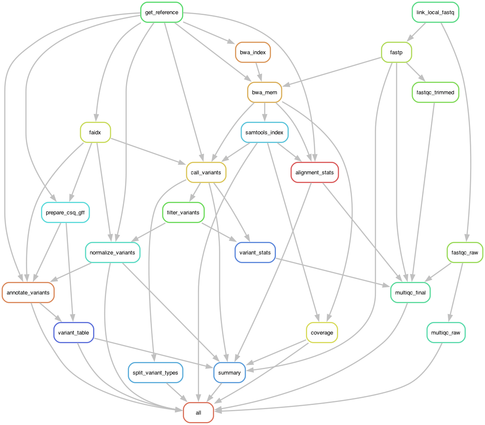

# Variant Discovery in Bacterial Genomes Using Short-Read Sequencing

Using this pipeline, we are trying to find different tyoes of variants:

- whether a SNP changes an amino acid (missense)
- creates a stop codon (stop_gained)
- changes nothing at the protein level (synonymous)
- or shifts the reading frame (frameshift). 


## Workflow Diagram

```
SRA download/local reads ─► FastQC (raw) ─► fastp ─► FastQC (trimmed) ─► MultiQC
                                  │
reference ─► bwa index / faidx    ▼
                 └──────────► BWA-MEM ─► samtools sort ─► index ─► flagstat / idxstats / stats / depth
                                                            │
                                                            ▼
                         bcftools mpileup | call (haploid) ─► raw VCF ─► SNP / indel VCFs, stats
                                                            │
                                         filter (QUAL≥30, DP≥10) ─► norm ─► bcftools csq
                                                                               │
                                                     variant_table.tsv + summary.tsv + MultiQC
```

## Rule graph




## Runtime and tool versions

Snakemake and Apptainer run the workflow; the bioinformatics tools used by each rule come from these pinned Docker Hub images. The image tag therefore determines the tool versions for that step.

| Workflow steps | Container image |
|---|---|
| SRA download | `docker://saharbagheri/bacterial-sra:1.0` |
| Read QC and trimming (FastQC, fastp, MultiQC) | `docker://saharbagheri/bacterial-qc:1.0` |
| Alignment and BAM processing (BWA, samtools) | `docker://saharbagheri/bacterial-alignment:1.0` |
| Variant calling, filtering, annotation and reporting (bcftools) | `docker://saharbagheri/bacterial-variants:1.0` |

The versions above are the tags referenced by the workflow rules. To change the tool versions, publish a new image tag and update the matching `container:` entries in `workflow/rules/`.

Host-side versions used when this README was updated:
- Snakemake: 9.27.2
- Apptainer: 1.5.5
- Python: 3.14.4


## Input Reads

This project supports two options in config/samples.tsv: If you use the sra column you can download data from SRA using the corresponding sample's SRA number (check the SRA_accession_example_samples.tsv file as an example), or you can put your local FASTQ files' paths in the fq1 and fq2 columns (check the local_reads_example_samples.tsv file as an example). 
Choose one option per sample; the workflow selects the appropriate input based on which columns are filled.

pipeline_run.sh always uses config/samples.tsv to learn about the input reads. For changing your sample sets, you have to change the rows in the samples.tsv file by editting the script.


## Quick start

1. on a Mac use the Lima section, on a cluster use the HPC section, and run the pipeline using the pipeline_run.sh script explained in next sections.


1.1. Running locally on macOS (Lima VM)

Snakemake runs the Docker Hub images through Apptainer, which only works on Linux.
On a Mac, the pipeline runs inside a small Linux VM managed by [Lima](https://lima-vm.io).

### 1. Create the VM (one time, on the Mac)

```bash
brew install lima

limactl start --name=apptainer --mount-writable template:apptainer

```

`--mount-writable` lets the VM write results into your Mac home folder.
If the VM already exists but is read-only:

```bash
exit #logout from the VM first
limactl stop apptainer
limactl edit apptainer --mount-writable
limactl start apptainer
limactl shell apptainer #Go back to the apptainer VM

```

if your jobs get kille ddue to memory issues you can fix that by allocating more memory if possible:

```bash
exit #logout from the VM first
limactl stop apptainer
limactl edit apptainer --memory 8 --cpus 4
limactl start apptainer
limactl shell apptainer #Go back to the apptainer VM

```

Note: Used memory and CPU numbers depend on the Mac. It also helps to note that the --cores 4 in pipeline_run.sh should match the VM's CPU count.
Make sure to keep plenty of disk space free, because the VM disk and run outputs grow quickly.


### 2. Open the VM

```bash
limactl shell apptainer
```

Your Mac folders appear at the same paths inside the VM (e.g. `/Users/<you>/...`).

### 3. Install Python, Snakemake and check Apptainer (one time, inside the VM)

```bash
# Python 3 + YAML (used by pipeline_run.sh) + pipx
sudo apt update
sudo apt install -y build-essential python3-dev python3-yaml python-is-python3 pipx

# Snakemake (installed globally for your user; no env to activate)
pipx install snakemake
pipx ensurepath
exec bash

# Apptainer is preinstalled by the Lima template; verify:
apptainer --version
```

Check everything works:

```bash
python --version
snakemake --version
apptainer exec docker://saharbagheri/bacterial-qc:1.0 fastp --version
```


### 4. Run the pipeline (every time)

```bash
limactl shell apptainer
cd /path/to/Bacterial_variant_calling
bash pipeline_run.sh
```

Set `run_dir` in `config/config.yaml` to a new folder for each run so earlier results aren't overwritten.

### Useful Lima commands (on the Mac)

```bash
limactl list              # show VMs and their status
limactl stop apptainer    # stop the VM when you're done
limactl start apptainer   # start it again later
pipx upgrade snakemake    # (inside the VM) update Snakemake
```

1.2. Running on an HPC cluster (SLURM + Apptainer)

Most clusters run Linux and provide Apptainer (or Singularity) as a module,
so the Docker Hub images can be used directly. Docker itself is not needed.

### 1. Get the code (one time)

```bash
cd /scratch/$USER            # or your project/work space; avoid small home quotas
git clone <your-repo-url> Bacterial_variant_calling
cd Bacterial_variant_calling
```

### 2. Load Apptainer and install Snakemake (one time)

```bash
module avail apptainer       # find the right name (sometimes "singularity")
module load apptainer
apptainer --version

# Snakemake + SLURM plugin (pipx; or use a conda/mamba env if pipx is unavailable)
python3 -m pip install --user pipx && python3 -m pipx ensurepath && exec bash
pipx install snakemake
pipx inject snakemake snakemake-executor-plugin-slurm pyyaml
snakemake --version
```

### 3. Store container images outside your home folder (recommended)

Images are ~0.2–0.6 GB each. Add these lines to `~/.bashrc`:

```bash
export APPTAINER_CACHEDIR=/scratch/$USER/apptainer_cache
export APPTAINER_TMPDIR=/scratch/$USER/apptainer_tmp
mkdir -p "$APPTAINER_CACHEDIR" "$APPTAINER_TMPDIR"
```

### 4. Create a SLURM profile: `workflow/profiles/hpc/config.yaml`

```yaml
executor: slurm
jobs: 50                              # max jobs queued at once
software-deployment-method: apptainer
apptainer-args: "--bind /scratch"     # bind the filesystem your project lives on
default-resources:
  slurm_account: "YOUR_ACCOUNT"
  slurm_partition: "YOUR_PARTITION"
  mem_mb: 8000
  runtime: 120                        # minutes
printshellcmds: true
rerun-incomplete: true
latency-wait: 60
```

### 5. Run

Snakemake runs and submits each step as a SLURM job.
Use can use `tmux` or `screen` so it keeps running after you log out:

  
You can save the bash script below as run_pipeline.sh. It starts the bacterial variant-calling pipeline inside a tmux session, loads Apptainer, and logs the Snakemake run. 
tmux lets the run continue after you disconnect from the cluster. To reconnect and check the progress run the following command: tmux attach -t pipeline


```bash
#!/usr/bin/env bash
set -euo pipefail

# Start this script from a login node.
# Attach later with: tmux attach -t pipeline

tmux new -s pipeline

module load apptainer

cd /scratch/$USER/Bacterial_variant_calling

RUN_DIR=$(python3 -c 'import yaml; print(yaml.safe_load(open("config/config.yaml"))["run_dir"])')
mkdir -p "$RUN_DIR/logs"

snakemake all \
  --workflow-profile workflow/profiles/hpc \
  --snakefile "$PWD/Snakefile" --directory "$RUN_DIR" \
  --configfile "$PWD/config/config.yaml" \
  --config samples="$PWD/config/samples.tsv" \
  --apptainer-prefix "$PWD/.snakemake/apptainer" \
  2>&1 | tee "$RUN_DIR/logs/run_$(date +%Y%m%d_%H%M%S).log"
```


The second way of running the pipeline is using SLURM jobs: Save this as run_pipeline.sbatch. Here, SLURM keeps it running after you disconnect.

```bash

#!/usr/bin/env bash
#SBATCH --job-name=bacterial-variants
#SBATCH --output=slurm-%j.out
#SBATCH --error=slurm-%j.err
#SBATCH --time=24:00:00
#SBATCH --cpus-per-task=1
#SBATCH --mem=4G

set -euo pipefail

module load apptainer
cd "/scratch/$USER/Bacterial_variant_calling"

RUN_DIR=$(python3 -c 'import yaml; print(yaml.safe_load(open("config/config.yaml"))["run_dir"])')
mkdir -p "$RUN_DIR/logs"

snakemake all \
  --workflow-profile workflow/profiles/hpc \
  --snakefile "$PWD/Snakefile" \
  --directory "$RUN_DIR" \
  --configfile "$PWD/config/config.yaml" \
  --config samples="$PWD/config/samples.tsv" \
  --apptainer-prefix "$PWD/.snakemake/apptainer" \
  2>&1 | tee "$RUN_DIR/logs/run_$(date +%Y%m%d_%H%M%S).log"

```

Submit this script from the cluster using:

sbatch run_pipeline.sbatch

Check the queue with squeue -u "$USER" 

View the SLURM output with less slurm-JOBID.out. Replace the time, memory, and account or partition settings as needed for your cluster.


## Configuration

Everything is set in `config/config.yaml`:

| Setting | Default | Notes |
|---|---|---|
| `samples` | `config/samples.tsv` | One row per sample. Use the `sra` column to download from SRA, or `fq1`/`fq2` for local `.fastq.gz` files. |
| `reference.fasta` / `.gff` | NCBI GCF_000017985.1 | A URL or a local path, gzipped or not. |
| `fastp.extra` | `--detect_adapter_for_pe` | Extra fastp options. |
| `mpileup` | MAPQ ≥ 20, BaseQ ≥ 20, max depth 1000 | |
| `call.ploidy` | `1` | Bacteria are haploid. |
| `filter.include` | `QUAL>=30 && INFO/DP>=10` | The guide's demonstration filter. Accepts any bcftools expression. |
| `coverage.low_depth` | `5` | Regions below this depth go to `*.low_coverage.bed`. |

To add samples, add rows to `config/samples.tsv`. Every step runs per sample.


## Outputs

Every run writes everything (data/, reference/, results/, logs/) into runs/<run_dir>/, not into the project root.


| Path | What it is | Guide step |
|---|---|---|
| `results/qc/multiqc_raw/multiqc_report.html` | Raw-read FastQC | 4 |
| `results/qc/fastp/{sample}.fastp.html` | Trimming report | 5 |
| `results/qc/multiqc_final/multiqc_report.html` | Raw and trimmed FastQC, fastp, samtools and bcftools in one report | 4–10 |
| `results/alignment/{sample}.sorted.bam(.bai)` | Sorted, indexed alignment. Load it in IGV. | 6–7 |
| `results/alignment/{sample}.{flagstat,idxstats,stats}.txt` | Mapping statistics | 8 |
| `results/alignment/{sample}.coverage.tsv` | Mean depth and % of genome at ≥1×, ≥10× and ≥30× | 8 |
| `results/alignment/{sample}.low_coverage.bed` | Low-coverage regions | 8 |
| `results/variants/{sample}.raw.vcf.gz` | All candidate variants | 10 |
| `results/variants/{sample}.{snps,indels}.vcf.gz` | Raw calls split by type | 10 |
| `results/variants/{sample}.filtered.norm.vcf.gz` | Filtered and normalised calls | 11 |
| `results/annotation/{sample}.annotated.vcf.gz` | Calls with `bcftools csq` consequences | 12 |
| `results/annotation/{sample}.variant_table.tsv` | **Interpretation table** (see below) | 13 |
| `results/summary/summary.tsv` | **All the numbers to record**, one row per sample | 4–11 |

`variant_table.tsv` has one row per filtered variant. For each it gives: position, REF/ALT, type,
QUAL, depth, REF/ALT read counts, ALT fraction and MAPQ. It also gives the gene, biotype and
product description, the consequence (missense, synonymous, stop_gained, frameshift, …), and
the protein change. For intergenic variants it names the flanking genes and gives the distance to each.

## Testing

The workflow was tested end to end on a simulated 54 kb genome with an NCBI-style GFF.
The GFF had genes on both strands, a tRNA and a pseudogene. Eight mutations were
planted in the reads. All eight were recovered with the correct consequences:
missense (on both strands), stop_gained, synonymous, a frameshift deletion, an in-frame
insertion, an intergenic SNP with its flanking genes, and a tRNA SNP.
Two samples were run together to check that multi-sample runs work.

## Manual steps the workflow doesn't do

- **IGV (guide step 6).** Load `runs/<run_dir>/reference/<name>.fasta` and
  `runs/<run_dir>/results/alignment/<sample>.sorted.bam`, go to a position from `variant_table.tsv`, and
  save a screenshot of a clean, high-confidence variant.
- **Biological interpretation (guide step 10).** Pick a few high-confidence variants from
  `variant_table.tsv` and look up the affected genes.

## Notes

- This pipeline has been tested by single and multiple samples, and the filters are project-specific: QUAL ≥ 30 and DP ≥ 10 are not universally correct. In a real research analysis, thresholds should be chosen and validated for the organism, sequencing design, expected ploidy, coverage and scientific question.

- There are unit tests in .tests/unit/ (one per rule) and you can run them by (pytest .tests/unit).

- This pipeline was tested by two datasets (E. coli REL606 and B. subtilis 168).

B. subtilis 168 reference file:
https://ftp.ncbi.nlm.nih.gov/genomes/all/GCF/000/009/045/GCF_000009045.1_ASM904v1/GCF_000009045.1_ASM904v1_genomic.fna.gz


B. subtilis reads:
SRR25470355
SRR25470356
SRR25470357
SRR25470358oo


E. coli REL606 reference file:
https://ftp.ncbi.nlm.nih.gov/genomes/all/GCF/000/017/985/GCF_000017985.1_ASM1798v1/GCF_000017985.1_ASM1798v1_genomic.fna.gz

E. coli reads:
SRR030256
SRR030257
SRR030258
